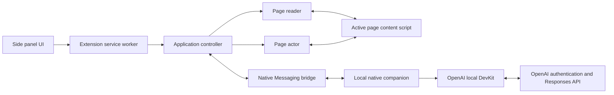

# Architecture

BrowseFriend is a local-first Chrome Manifest V3 side-panel extension backed by a native Node.js
companion. The extension owns presentation, page reading, and transient chat state. The companion
owns credentials, OpenAI authentication, model discovery, and model requests.

## System overview

The side panel sends user intents and renders state owned by the service worker's application
controller. Connection readiness and the active submission are orthogonal state machines: setup can
continue while a user cancels a queued prompt, and stable IDs prevent late asynchronous results from
reviving cancelled work. One normalized notice represents the current authentication action or
recoverable connection/chat error.

The page reader injects `extension/page/read/content-script.js` only into supported HTTP or HTTPS
pages and returns a bounded semantic snapshot. The application controller combines that snapshot
with eligible local conversation history, selects an available model, and streams deltas through the
side panel.

The page actor is a separate mutation boundary. It accepts only shared typed-tool schemas, resolves
opaque refs from the current snapshot, classifies risk from the live DOM, and rejects stale or
sensitive targets. The application controller owns Act authorization, confirmation, the bounded
tool loop, and recapture between steps; it never receives arbitrary selectors or scripts.

Chrome connects the service worker to `com.browsefriend.native_host` through Native Messaging. The
companion validates its small request allowlist, keeps authentication and model handlers separate,
and delegates OAuth, token refresh, account selection, model discovery, and Responses streaming to
the pinned DevKit. Setup applies a tracked downstream patch while building so the otherwise
text-focused DevKit can carry typed function calls, results, and model-supported reasoning effort
without exposing OAuth credentials.

## Main flows

### Authentication

Opening the panel immediately shows chat and starts a single background readiness operation. The
controller launches the companion, reads saved authentication, refreshes credentials when needed,
and discovers available models. If user action is required, the panel presents **Continue with
ChatGPT** without discarding a draft or queued prompt. The companion temporarily listens on a random
`127.0.0.1` port for the OAuth callback. The DevKit validates the result and persists encrypted
credentials; only sanitized account state returns to the extension.

### Ask mode

Submitting a prompt creates one cancellable submission. It may wait for shared readiness, then
captures the active page, stores a user/assistant pair, and starts one model request. Stop restores
the prompt as a draft without cancelling readiness; stable submission IDs discard late capture or
stream results. Page content is wrapped as untrusted data rather than instructions. DOM mutations or
navigation advance the page revision, allowing the controller to mark captured context and its
answer as stale. Retrying a failed response recaptures the page and replaces the failed attempt.

### Act mode

Ask is the default. Enabling Act captures the active page and creates one global session
authorization tied to its tab and origin. Submitting freezes the mode, tab, starting origin, and
current location into the task. The task—not the global toggle—then owns Act authority until a
terminal state, allowing model-directed HTTP(S) navigation in the same tab without toggling modes
between pages. If the task ends on a different origin, the global mode returns to Ask. Manual
navigation outside action execution or any tab switch stops the response with an explicit error.
New chat, logout, and session loss also clear Act; BrowseFriend does not remember it per tab.

Act remains capable of ordinary text answers, but the native model handler additionally exposes the
allowlisted schemas in `shared/page-tools.js`. The model may request one tool at a time. The actor
prepares the target without mutation, and the
controller either executes a low-risk action or pauses in one pending-confirmation state.
Submissions, detected downloads, ambiguous controls, and consequential changes require confirmation.
File selection instead highlights the page control and waits for a direct user choice. Each result
is followed by a fresh semantic capture. Surviving DOM nodes retain opaque refs; replaced nodes get
new refs, and stale calls return a non-executing result so the model can replan. A 32-call limit and
same-revision repeat guard stop runaway loops.

Direct navigation is a background-owned action that validates an absolute HTTP(S) URL, updates the
authorized tab, waits for a different readable document, and recaptures it before the next model
step. BrowseFriend provides no separate search service: the model may choose a known destination or
navigate to a site/search listing and inspect its links. If the model returns text instead of another
tool call, the task is complete even when that text reports ambiguity or another blocker.

### Model context and instructions

The shared Responses API instruction string is `BASE_MODEL_INSTRUCTIONS` in
`native-host/model/handler.mjs`. It defines the untrusted-page boundary; Ask adds a read-only guard,
while Act adds tool policy. Each request contains eligible transcript pairs, current-page context,
the original prompt, and any compact current-run action continuation. Earlier page snapshots are not
copied into transcript history.

The model owns semantic planning: interpreting the request, choosing and sequencing allowed tools,
ranking plausible targets, and stopping when ambiguity prevents a confident choice. Extension code
does not duplicate those judgments. It retains deterministic responsibility for validation,
authorization, confirmations, sensitive-data rules, stale-target checks, resource limits, and state
transitions because those boundaries must hold even when model judgment is wrong.

The pinned DevKit sends each request with `store: false` and without a `conversation` or
`previous_response_id`. Sign in with ChatGPT plan access does not grant BrowseFriend access to the
user's ChatGPT conversations or memory; the model receives only the context BrowseFriend supplies.

### Settings and state

Theme, accent color, model, reasoning effort, and Debug preferences use `chrome.storage.local` and
synchronize between open panels through `chrome.storage.onChanged`. Reasoning defaults to the
effective model's advertised default and omits the API override; supported explicit efforts are
listed from highest to lowest. Changing models resets an incompatible explicit effort to Model
default. The background and side panel share the same model resolver: Automatic selects the first
catalog model, while the chat footer resolves preference labels into the model and advertised effort
expected for the next request. It omits the effort summary when the catalog provides no default. The
active conversation uses one global
`chrome.storage.session` record shared across panels and windows. It survives service-worker
suspension but not a browser restart or extension reload. New chat and logout clear it. The companion
stores account data in the platform application-data directory and encrypts credentials with a key
protected by macOS Keychain or Linux Secret Service.

## Trust boundaries

- Page content is untrusted and must never become developer guidance or an implicit action request.
- OAuth credentials and refresh tokens stay in the native companion and never enter extension
  storage, messages, logs, URLs, tests, or commits.
- Runtime and native messages accept only known senders and allowlisted operations; public errors and
  account state are sanitized before crossing into the extension.
- Model requests use `store: false`. BrowseFriend does not read ChatGPT cookies, conversations,
  memory, or private endpoints.
- Page extraction, model communication, and action execution remain separate. Consequential actions
  require explicit user confirmation and stale-target validation in extension code, independent of
  model instructions.

See [Known Limitations](KNOWN_LIMITATIONS.md) for current constraints and the [Roadmap](TODO.md) for
deferred architecture work.
