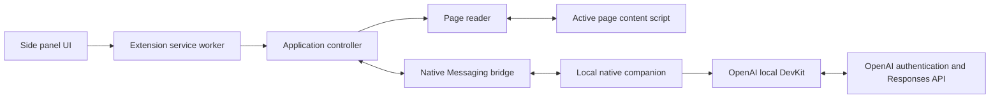

# Architecture

BrowseFriend is a local-first Chrome Manifest V3 side-panel extension backed by a native Node.js
companion. The extension owns presentation, page reading, and transient chat state. The companion
owns credentials, OpenAI authentication, model discovery, and model requests.

## System overview

The side panel sends user intents and renders state owned by the service worker's application
controller. Connection readiness and the active submission are orthogonal state machines: setup can
continue while a user cancels a queued prompt, and stable IDs prevent late asynchronous results from
reviving cancelled work. One normalized notice represents the current authentication action or
recoverable connection/chat error.

The page reader injects `extension/page/read/content-script.js` only into supported HTTP or HTTPS
pages and returns a bounded semantic snapshot. The application controller combines that snapshot
with eligible local conversation history, selects an available model, and streams deltas through the
side panel.

Chrome connects the service worker to `com.browsefriend.native_host` through Native Messaging. The
companion validates its small request allowlist, keeps authentication and model handlers separate,
and delegates OAuth, token refresh, account selection, model discovery, and Responses streaming to
the pinned DevKit.

## Main flows

### Authentication

Opening the panel immediately shows chat and starts a single background readiness operation. The
controller launches the companion, reads saved authentication, refreshes credentials when needed,
and discovers available models. If user action is required, the panel presents **Continue with
ChatGPT** without discarding a draft or queued prompt. The companion temporarily listens on a random
`127.0.0.1` port for the OAuth callback. The DevKit validates the result and persists encrypted
credentials; only sanitized account state returns to the extension.

### Ask mode

Submitting a prompt creates one cancellable submission. It may wait for shared readiness, then
captures the active page, stores a user/assistant pair, and starts one model request. Stop restores
the prompt as a draft without cancelling readiness; stable submission IDs discard late capture or
stream results. Page content is wrapped as untrusted data rather than instructions. DOM mutations or
navigation advance the page revision, allowing the controller to mark captured context and its
answer as stale. Retrying a failed response recaptures the page and replaces the failed attempt.

### Settings and state

Theme, model, and Debug preferences use `chrome.storage.local` and synchronize between open panels
through `chrome.storage.onChanged`. The active conversation uses `chrome.storage.session`, so it can
survive service-worker suspension but not a browser restart or extension reload. The companion stores
account data in the platform application-data directory and encrypts credentials with a key protected
by macOS Keychain or Linux Secret Service.

## Trust boundaries

- Page content is untrusted and must never become developer guidance or an implicit action request.
- OAuth credentials and refresh tokens stay in the native companion and never enter extension
  storage, messages, logs, URLs, tests, or commits.
- Runtime and native messages accept only known senders and allowlisted operations; public errors and
  account state are sanitized before crossing into the extension.
- Model requests use `store: false`. BrowseFriend does not read ChatGPT cookies, conversations, or
  private endpoints.
- Page extraction, model communication, and future action execution remain separate. Consequential
  actions require explicit user confirmation and stale-target validation.

See [Known Limitations](KNOWN_LIMITATIONS.md) for current constraints and the [Roadmap](TODO.md) for
deferred architecture work.
