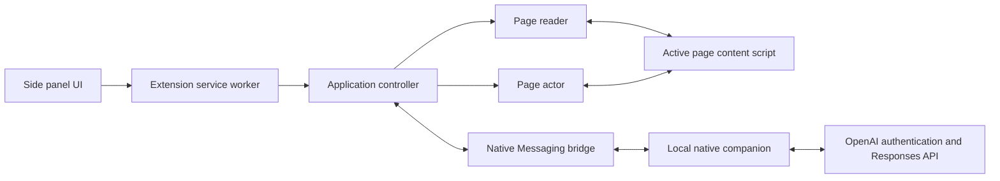

# Architecture

BrowseFriend is a local-first Chrome Manifest V3 side-panel extension backed by a native Go
companion. The extension owns presentation, page reading, and transient chat state. The companion
owns credentials, OpenAI authentication, model discovery, and model requests.

## System overview

The side panel sends user intents and renders state owned by the service worker's application
controller. Connection readiness and the active submission are orthogonal state machines. New
prompts require a ready connection; an explicit response retry may wait for connection recovery.
Stable IDs prevent late asynchronous results from reviving cancelled work. One normalized notice
represents the current authentication action or recoverable connection/chat error. Startup and explicit
sign-in share one readiness pipeline. Account epochs guard catalog results and setting changes before
they can update state. A panel transport error stays view-local: Retry reads authoritative controller
state instead of replaying the uncertain intent.

The page reader injects `extension/page/read/content-script.js` only into supported HTTP or HTTPS
pages and returns a bounded semantic snapshot. The application controller combines that snapshot
with eligible local conversation history, selects an available model, and streams deltas through the
side panel.

The page actor is a separate mutation boundary. It accepts only shared typed-tool schemas, resolves
opaque refs from the current snapshot, classifies risk from the live DOM, and rejects stale or
sensitive targets. The application controller owns Act authorization, confirmation, the bounded
tool loop, and recapture between steps; it never receives arbitrary selectors or scripts.

Chrome connects the service worker to `com.browsefriend.native_host` through Native Messaging. The
companion validates its small request allowlist and keeps authentication and model handlers separate.
The companion implements the documented OAuth, discovery, token renewal, Responses streaming, and compaction protocols directly. ID tokens are verified with `coreos/go-oidc` and `go-jose`; HTTP and cryptography use Go’s standard library.

## Main flows

### Native companion

The standalone Go executable implements the allowlisted auth/model messages and events that the
extension's Native Messaging bridge expects. Its code separates framing, request state, OAuth,
registration metadata, model HTTP/SSE transport, and installation. The installer copies and
atomically registers the executable; the installed process needs no language runtime.

Platform-specific adapters implement secure files, browser launching, and per-user Chrome
registration. Windows retains protected user/SYSTEM ACLs and HKCU registration; Unix retains
owner-only file protections. Existing unsafe Windows ACLs fail validation rather than being repaired.

The native store owns a versioned `credentials.json` record (maximum 2 MiB), containing the account,
tokens, scopes, expiry information, and any pending refresh successor. It is protected by owner-only
Unix permissions or the existing Windows ACL policy, without application-level encryption or a
keyring dependency. `registration.json` separately retains `hostId`, `clientId`, and `subject`.
Authenticated credential records must match that registration and the generation in protected,
non-secret `auth-state.json`. Its disabled marker prevents an unfinished sign-in or a running old
process from restoring credentials after uninstall, including when the companion is reinstalled.

Every account operation reloads current disk state under the validated `registration.lock`
interprocess lock. A process-local gate also serializes operations on one store. Saves commit
independently through flushed private temporary files and atomic replacement. Lock acquisition
retries every 25 ms for up to 45 seconds, respecting cancellation and validating held-file identity.
Refresh rotation holds this lock and checkpoints the received successor before identity verification.
A later cancellation or signing-key outage cannot roll back that checkpoint. Failed writes retain a
bounded successor in memory and retain the interprocess lock until it commits, explicit cleanup
replaces it, or the store closes. Other processes cannot read and replay the spent on-disk grant.
Revision/generation checks reject obsolete checkpoints. A crash before a replacement can be saved
may require fresh sign-in. Installation uses the same lock. Each locked operation sweeps abandoned
private `.browsefriend-*` atomic-write files left by interrupted writers.

`shared/host-contract.json` is the canonical policy/tool/limits/registration definition. Go embeds it
directly; `go generate ./shared` produces the committed browser module. Verification rejects drift.
The browser still owns semantic page capture and action authorization; Go only transports model
tool requests back through that established boundary.

Logout attempts remote revocation and clears local credentials while retaining registration.
Logout/reset rotate the durable authentication generation and write an empty credential record.
Uninstall rotates that generation, disables the store, and removes the credential file; reinstall
reenables it under a fresh generation. The non-secret lifecycle barrier survives file removal.
Connections emit sanitized account changes when they observe another process's generation change.
One handler invalidation path cancels active work and clears Act/compaction memory. Model and catalog
responses recheck their captured generation before returning, even if Status already observed the change.
Normal updates preserve compatible records. Corrupt or unsupported records remain untouched until
an explicit, confirmed reset; unsafe paths and permissions are never reset automatically.
There is no migration framework, legacy account loading, or cleanup utility. Earlier encrypted
files and OS-keyring entries are ignored. The retired storage comparison remains historical in
[Storage evaluation](STORAGE_EVALUATION.md).

See [Native companion](NATIVE_HOST.md) for commands, storage names, and the verification record.

Build and distribution are separate from the installed runtime. The Go build helper creates native
production binaries and packages them with project/dependency licenses and checksums. GitHub CI is
configured to test six native targets with synthetic accounts and temporary registration directories before uploading
development artifacts; hosted execution remains pending until the first push. See [CI](CI.md).

### Authentication

Opening the panel immediately shows chat and starts a single background readiness operation. The
composer, suggested prompts, and Ask/Act controls remain disabled until authentication and model
discovery finish; Settings stays accessible. The controller launches the companion, restores saved native
authentication, refreshes credentials when needed, and discovers available models. If user action is
required, the panel presents **Continue with ChatGPT** without discarding an existing draft. New
prompts are rejected before readiness and never queued across sign-in. The companion temporarily
listens on a random `127.0.0.1` port for the OAuth callback. The companion validates the result and
saves validated credentials in protected native storage; only sanitized account state returns to the
extension. Startup restoration never opens OAuth or submits a draft automatically. The controller
routes confirmed `app.resetLogin` intent to native `auth.reset`; native reset cancels sign-in/model
work and invalidates authentication-scoped context. Storage failures are typed separately from
reauthentication and corrupt-record recovery.

### Ask mode

Submitting a prompt requires a ready connection and creates one cancellable submission that
captures the active page, stores a user/assistant pair, and starts one model request. Stop restores
the prompt as a draft without cancelling readiness; stable submission IDs discard late capture or
stream results. Page content is wrapped as untrusted data rather than instructions. DOM mutations or
navigation advance the page revision, allowing the controller to mark captured context and its
answer as stale. Retrying a failed response recaptures the page and replaces the failed attempt.

### Act mode

Ask is the default. Enabling Act captures the active page and creates one global session
authorization tied to its tab and origin. Submitting freezes the mode, tab, starting origin, and
current location into the task. The task—not the global toggle—then owns Act authority until a
terminal state, allowing model-directed HTTP(S) navigation in the same tab without toggling modes
between pages. If the task ends on a different origin, the global mode returns to Ask. Manual
navigation outside action execution or any tab switch stops the response with an explicit error.
New chat, logout, and session loss also clear Act; BrowseFriend does not remember it per tab.

Act remains capable of ordinary text answers, but the native model handler additionally exposes the
allowlisted schemas in `shared/page-tools.js`. The model may request one tool at a time. The actor
prepares the target without mutation, and the
controller either executes a low-risk action or pauses in one pending-confirmation state.
Submissions, detected downloads, ambiguous controls, and consequential changes require confirmation.
File selection instead highlights the page control and waits for a direct user choice. Each result
is followed by a fresh semantic capture. Surviving DOM nodes retain opaque refs; replaced nodes get
new refs, and stale calls return a non-executing result so the model can replan. A 32-call limit and
same-revision repeat guard stop runaway loops.

Direct navigation is a background-owned action that validates an absolute HTTP(S) URL, updates the
authorized tab, waits for a different readable document, and recaptures it before the next model
step. BrowseFriend provides no separate search service: the model may choose a known destination or
navigate to a site/search listing and inspect its links. If the model returns text instead of another
tool call, the task is complete even when that text reports ambiguity or another blocker.

### Model context and instructions

The shared Responses API instruction string is `baseInstructions` in
`shared/host-contract.json`. It defines the untrusted-page boundary; Ask adds a read-only guard,
while Act adds tool policy. Ask sends eligible transcript pairs, current-page context, and the
original prompt. Act initializes those inputs once, then Go retains canonical model output items
and appends each matching tool result with its fresh page observation in chronological order.
This includes opaque encrypted reasoning when provided; only validated tool calls and streamed text
cross back into the extension. The controller remains the owner of tool execution and authorization.

The native handler owns one Act conversation buffer, keyed by submission ID with frozen model,
effort, and prompt. Continuations must match its pending call ID, name, and arguments. Historical
captures are untrusted observations; only the latest capture supplies current controls, and the actor
still validates the current document/revision. Earlier snapshots never become transcript history.

The buffer lives only in Go memory, outside Chrome storage, UI state, logs, and transcript compaction.
It survives waits within that task, including confirmations, but ends on completion, failure, Stop,
manual navigation/tab changes, declined or cancelled handoffs, account changes, or companion exit.
The controller uses one terminal cleanup path and scoped cancellation also clears an idle buffer;
late callbacks cannot revive cancelled context or clear a newer submission. A fresh task replaces any
abandoned buffer. Lost context requires a fresh prompt rather than an implicit restart. Its shared
8-MiB serialized-item budget stops oversized tasks through the existing error flow; there is no
mid-task truncation or compaction. This byte bound does not guarantee fitting every model's context
window; API context-limit errors remain possible.

The controller retains completed user/assistant exchanges in the memory-only chat session. When
reusable context exceeds 256 KiB, it sends only older transcript prose in a separate tool-free
`/responses` request with `context_management: [{type: "compaction", compact_threshold: 1000}]`,
retains the returned opaque canonical items in a separate Go cache capped at 320 KiB, and
keeps the latest eight exchanges verbatim. Only those recent exchanges include visible Act action
records; older action labels and values are neither compacted nor resent. Page snapshots, system
instructions, and current-run tool payloads never enter transcript compaction. Compacted data is
model-specific because it is opaque model-generated state; BrowseFriend cannot safely assume that a
different model can interpret it with the same semantics. A model change therefore invalidates
incompatible compacted context, New chat clears it, and unsupported or malformed compaction falls
back to the existing bounded raw-history path.

The checkpoint request uses `store: false`, `stream: true`, and the ordinary base instructions
from the shared contract. No checkpoint-only developer policy is introduced, since it can be
encoded in opaque state and interfere with later user requests. The provider emits canonical
compaction items in its stream; Go retains
only the latest one and discards incidental generated text/reasoning. No page tools are supplied
or accepted for this request. This adds one inference request when compacting; ordinary Ask/Act
generations are unchanged. The 1,000-token provider threshold is separate from the browser's
256-KiB eligibility trigger. If the eligible prefix produces no checkpoint yet, keep its raw prose
and any previous handle and try again when it grows. Errors, cancellation, and invalid output never
replace a valid cached checkpoint.

The dedicated `/responses/compact` route returned HTTP 401 `hardened_oauth_rule_missing` with the
tested ChatGPT OAuth connection. In-band compaction through the documented `/responses` route
worked with the existing documented scopes; no extra permission or private endpoint was needed.

The chat has a stable `conversationId` until New chat or logout. `model.compact` accepts this ID,
model, bounded older prose, and an optional prior `contextHandle`; it returns only a new opaque
handle and the actual UTF-8 byte count. Chrome saves `{model, handle, bytes, throughAssistantId,
throughCreatedAt}` and uses the byte count for history budgeting. `model.stream` resolves that
handle in Go only for Ask or the initial Act input. Act continuations send no transcript history or
handle, using the separate retained task buffer instead.

The handler owns one compaction cache scoped by conversation, model, and authentication generation.
`model.context.clear` clears only the named conversation. Model/auth changes and process exit also
invalidate the cache; cancellation and epochs prevent late completions from repopulating cleared
state. Cancelled, unsupported, malformed, or oversized replacement preserves an existing valid
cache. Native validation enforces actual sizes independently of browser metadata. An expired handle
fails with `model_context_lost` before provider access; the controller discards its checkpoint and
uses bounded available prose once for a fresh request. It never restarts an Act continuation or
replays executed page actions. Visible transcript, snapshots, settings, and safety state stay in Chrome.

The model owns semantic planning: interpreting the request, choosing and sequencing allowed tools,
ranking plausible targets, and stopping when ambiguity prevents a confident choice. Extension code
does not duplicate those judgments. It retains deterministic responsibility for validation,
authorization, confirmations, sensitive-data rules, stale-target checks, resource limits, and state
transitions because those boundaries must hold even when model judgment is wrong.

The companion sends each generation with `store: false` and without a `conversation` or
`previous_response_id`; compaction is a separate stateless request whose output is supplied directly
to later generations. Sign in with ChatGPT plan access does not grant BrowseFriend access to the
user's ChatGPT conversations or memory; the model receives only the context BrowseFriend supplies.

### Settings and state

Panel layout uses ordinary responsive CSS and the browser-reported viewport. Native browser/window
clipping at very narrow tiled widths is accepted as a [known limitation](KNOWN_LIMITATIONS.md#side-panel-layout);
the extension does not compensate for it with viewport overrides or window-manager integration.

Theme, accent color, transcript typography, model, reasoning effort, and Debug preferences use
`chrome.storage.local` and synchronize between open panels through `chrome.storage.onChanged`.
The application controller serializes model/effort writes and compatibility repair, then publishes the
canonical values with its catalog. Panels send setting intents and render that state; rendering
never writes preferences. Appearance and Debug remain independent panel preferences.
Seven independent typography fields control prompt font/size/bold/italic and response text font,
code font, and shared size.
The side panel reads installed font names through `fontSettings.getFontList()` when Settings opens;
the `fontSettings` permission is never used to change browser-wide fonts. The list stays in panel
memory, outside model requests and the native companion. Scoped CSS updates history, streaming text,
and live samples without rebuilding messages. Default retains inherited text typography; response
code defaults to the system monospace stack and uses the same size as response prose. Missing fonts
fall back to their respective defaults without deleting the user's selection, and discovery failures
do not block other settings or authentication.

Reasoning defaults to the effective model's advertised default and omits the API override; supported explicit efforts are
listed from highest to lowest. Changing models resets an incompatible explicit effort to Model
default. The background and side panel share the same model resolver: Automatic selects the first
catalog model, while the chat footer resolves preference labels into the model and advertised effort
expected for the next request. It omits the effort summary when the catalog provides no default. The
active conversation uses one global
`chrome.storage.session` record shared across panels and windows. It survives service-worker
suspension but not a browser restart or extension reload. New chat presents a cancel-first
confirmation and, when accepted, rotates the conversation ID and clears transcript and native
compaction; logout clears them directly. Chrome retains compaction metadata, never its payload.
The companion stores protected credentials and separate registration identifiers in the platform
application-data directory. Browser/companion restart restores login while renewable credentials
remain valid; visible chat and native task context retain their existing transient lifetimes.

## Trust boundaries

- Page content is untrusted and must never become developer guidance or an implicit action request.
- OAuth credentials and refresh tokens stay in the native companion and never enter extension
  storage, messages, logs, URLs, tests, or commits.
- Runtime and native messages accept only known senders and allowlisted operations; public errors and
  account state are sanitized before crossing into the extension.
- Model requests use `store: false`. BrowseFriend does not read ChatGPT cookies, conversations,
  memory, or private endpoints.
- Page extraction, model communication, and action execution remain separate. Consequential actions
  require explicit user confirmation and stale-target validation in extension code, independent of
  model instructions.

See [Known Limitations](KNOWN_LIMITATIONS.md) for current constraints and the [Roadmap](TODO.md) for
deferred architecture work.

## Evaluation boundary

The browser-free [Act evaluation harness](EVALUATIONS.md) runs production page extraction, actions, and controller code against trusted HTML in jsdom. An evaluation-only Go executable reuses the handler and model transport with baseline/candidate or blinded grading instructions. The evaluator explicitly uses a memory-only native store, sharing registration identifiers while never reading or writing production credentials; logout and saved-login reset are disabled. Each evaluator authenticates once and
retains its Go process across cases; evaluation-only mode changes clear task context while idle. No browser registration or runtime endpoint is added to BrowseFriend.
